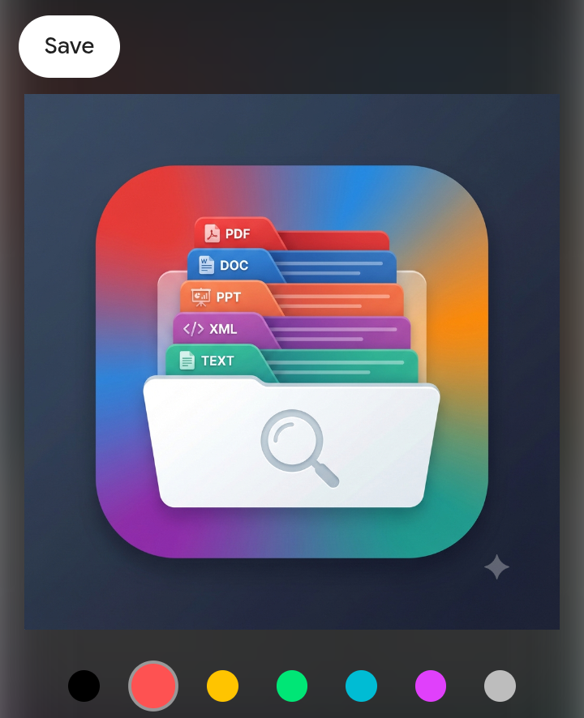
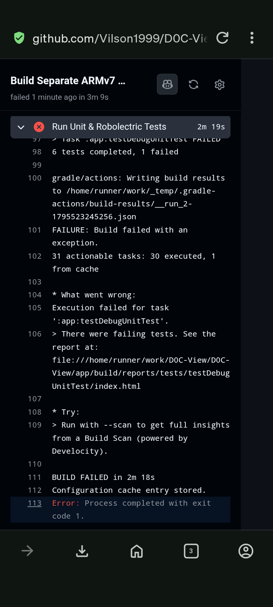
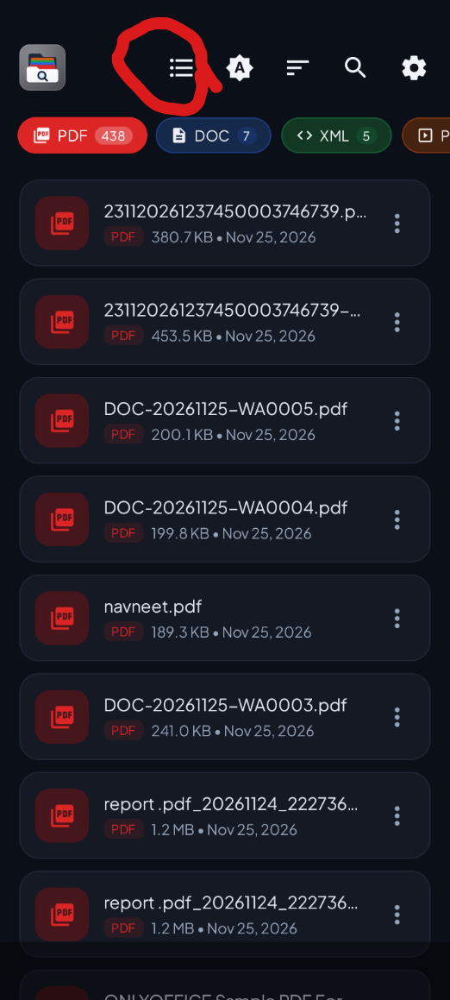

<table>
  <tr>
    <td><span style="font-size: 3rem;">🗂️</span></td>
    <td><h1>D0C View</h1></td>
  </tr>
</table>

**Developer:** Vilson Sonkar · **App language:** Kotlin

> An offline document viewer for finding and reading documents stored on your Android device. No internet connection or data collection.

## Screenshots

<table>
  <tr>
    <td></td>
    <td></td>
    <td></td>
  </tr>
</table>

## App details

### Supported document categories

| Category | Supported extensions |
| --- | --- |
| PDF | `.pdf` |
| Word documents (DOC) | `.doc`, `.docx`, `.rtf` |
| XML | `.xml` |
| Presentations (PPT) | `.ppt`, `.pptx` |
| Text and data (TEXT) | `.txt`, `.log`, `.md`, `.csv`, `.json`, `.ini`, `.cfg` |

### Finding and managing files

- Scans device storage for supported files, including internal and external storage.
- Can include hidden folders and files whose names begin with a dot.
- Supports user-selected folders and importing individual files.
- Browse documents by file category; search, sort, select, share, print, rename, and delete files.
- Open supported documents shared or opened from other apps.

### Reading

- Read PDFs, Word documents, PowerPoint presentations, XML, and plain-text files in the app.
- Switch between single-page and continuous reading modes.
- PDF pages support zooming; reader controls can automatically hide while reading.
- Adjust reader text size and configure XML syntax highlighting and line numbers.
- Converted document previews are cached locally for smoother subsequent viewing.

### Personalization and storage

- System, light, and dark themes.
- Choose which document categories appear on the home screen.
- Configure hidden-folder scanning, linked folders, and default page-view mode.
- Manage temporary rendering cache, including automatic cleanup.

### Privacy

D0C View is designed to work offline. The Android manifest removes internet and network-state permissions. Storage access is requested so the app can scan folders you authorize; grant only the access you are comfortable with.

## Platform and technology

| Detail | Value |
| --- | --- |
| Platform | Android |
| Minimum Android version | Android 9 (API 28) |
| App language | Kotlin |
| UI | Jetpack Compose and Material 3 |
| Current project version | 1.2 |
| Application ID | `com.docview.vilson` |
| License | GNU General Public License v3.0 (GPL-3.0) |

## Build from source

**Requirements:** JDK 21 and Android SDK (the project compiles against Android API 36).

```bash
git clone https://github.com/Vilson1999/D0C-View.git
cd D0C-View
./gradlew assembleDebug
```

The debug APK is generated under `app/build/outputs/apk/`.

## Developer

**Vilson Sonkar**

## License

This project is licensed under the [GNU General Public License v3.0](LICENSE).
